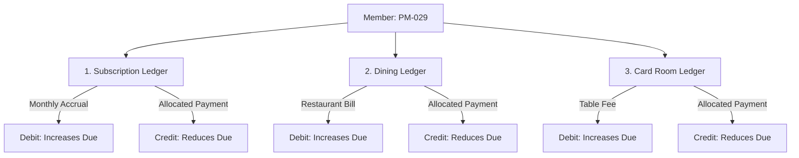

# Accounting Standards & Voucher Workflow Specifications

## 1. Chart of Accounts (COA) Structure

The club utilizes a standardized 4-tier numeric Chart of Accounts with **Control A/C Heads** and **Sub-Codes**:

```
1000 ASSETS
├── 1100 Current Assets
│   ├── 1101 Cash in Hand (Main Cash Desk)
│   ├── 1102 Petty Cash (Secretary Office)
│   ├── 1110 Bank Accounts
│   │   ├── 1111 Sonali Bank (Main Operations A/C)
│   │   └── 1112 Dhaka Bank (Development Fund A/C)
│   └── 1120 Member Receivables (Control Heads)
│       ├── 1121 Member Subscription Receivable
│       ├── 1122 Member Dining Receivable
│       └── 1123 Member Card Room Receivable
└── 1200 Fixed & Non-Current Assets
    ├── 1201 Club Land & Buildings
    ├── 1202 Furniture & Fixtures
    └── 1203 Billiard & Card Room Equipment

2000 LIABILITIES
├── 2100 Current Liabilities
│   ├── 2101 Accounts Payable (Suppliers / Vendors)
│   ├── 2102 Member Advance Payments (Credit Balances)
│   └── 2103 Accrued Utility Charges (Electricity / Gas / Water)
└── 2200 Long-Term Liabilities

3000 EQUITY / CLUB FUNDS
├── 3101 General Club Capital Fund
└── 3102 Retained Surplus / (Deficit)

4000 REVENUE / INCOME
├── 4100 Membership Incomes
│   ├── 4101 Annual / Monthly Member Subscription
│   ├── 4102 Member Admission & Registration Fees
│   └── 4103 Guest Entry Fees
├── 4200 Facility Operations Income
│   ├── 4201 Dining Room & Restaurant Sales
│   ├── 4202 Beverage & Bar Sales
│   └── 4203 Card Room Table Charges & Gaming Fees
└── 4300 Miscellaneous Income (Hall Rent, Lawn Bookings)

5000 EXPENSES (SUB-CODES / CATEGORIES)
├── 5100 Administrative Expenses
│   ├── 5101 Staff Salaries & Allowances
│   ├── 5102 Printing, Stationery & Computer Supplies
│   ├── 5103 Telephone & Internet
│   └── 5104 Entertainment & Meeting Expenses
├── 5200 Dining & Catering Expenses
│   ├── 5201 Food & Grocery Purchases
│   ├── 5202 Beverage & Consumables
│   └── 5203 Kitchen Gas & Kitchen Equipment Maintenance
├── 5300 Card Room & Sports Expenses
│   ├── 5301 Card Room Supplies & Playing Cards
│   └── 5302 Sports & Tournament Equipment
└── 5400 Club Maintenance & Utilities
    ├── 5401 Electricity & Generator Fuel
    ├── 5402 Water & Sanitation Charges
    └── 5403 Building Repairs & Painting
```

---

## 2. The 6 Core Voucher Types

| Voucher Code | Voucher Title | Standard Debit Side | Standard Credit Side | Usage Scenario |
| :---: | :---: | :---: | :---: | :--- |
| **`J3`** | **Journal Voucher** | Any Non-Cash Head | Any Non-Cash Head | Monthly member subscription accruals, year-end adjustments, depreciation. |
| **`P1`** | **Cash Payment** | Expense / Payable | Cash in Hand (`1101`/`1102`) | Office supplies, kitchen petty cash purchases, casual labor payments. |
| **`R1`** | **Cash Receive** | Cash in Hand (`1101`) | Member Receivable / Income | Member cash payments, cash receipts for dining chits or guest fees. |
| **`P2`** | **Bank Payment** | Vendor / Asset / Expense | Bank Head (`1111`/`1112`) | Supplier cheque payments, utility bill direct bank debits, salary transfers. |
| **`R2`** | **Bank Receive** | Bank Head (`1111`/`1112`) | Member / Other Income | Online bank deposits from members, interest income, wire transfers. |
| **`C3`** | **Contra Voucher** | Cash or Bank | Bank or Cash | Cash drawn from bank for petty cash, or daily cash collections deposited into bank. |

---

## 3. Member 3-Sub-Ledgers Architecture

Every registered member has three independent running sub-ledgers. 



### Sub-Ledger Calculation Formula:
$$\text{Subscription Due} = \sum \text{Debit}_{\text{sub}} - \sum \text{Credit}_{\text{sub}}$$
$$\text{Dining Due} = \sum \text{Debit}_{\text{din}} - \sum \text{Credit}_{\text{din}}$$
$$\text{Card Room Due} = \sum \text{Debit}_{\text{cr}} - \sum \text{Credit}_{\text{cr}}$$
$$\text{Total Member Outstanding} = \text{Subscription Due} + \text{Dining Due} + \text{Card Room Due}$$

---

## 4. Payment Allocation Rules

When a member makes a payment (via Cash Receive `R1` or Bank Receive `R2`), the ERP supports two allocation workflows:

### Method A: Manual Allocation (User Choice)
The finance officer enters the specific amounts being settled:
* Example: Member pays ৳7,000 against Subscription (৳4,000), Dining (৳2,000), and Card Room (৳1,000). The user directly assigns these three fields in the payment modal.

### Method B: Automated Priority Allocation (FIFO)
If enabled, the payment is systematically allocated using the club's standard priority hierarchy:
1. **Priority 1:** Subscription Dues (Oldest bills settled first).
2. **Priority 2:** Dining Room Bills (Oldest chits settled first).
3. **Priority 3:** Card Room Charges.
4. **Surplus Handling:** Any remaining balance is credited to **Member Advance Payable (`2102`)** and automatically offsets the member's next monthly bill.

---

## 5. Voucher Lifecycle & Immutability Rules

```
 ┌─────────────┐       User saves draft
 │    DRAFT    │ ────────────────────────────┐
 └──────┬──────┘                             │
        │ Move to batch queue                ▼
 ┌──────▼──────┐                     ┌───────────────┐
 │   QUEUED    │ ───────────────────►│ CALL QUEUE /  │
 └──────┬──────┘   Accountant loads  │ PREVIEW DRAFT │
        │                            └───────────────┘
        │ Post voucher (Diff == 0 enforced)
 ┌──────▼──────┐
 │   POSTED    │  ◄── [LOCKED & IMMUTABLE: Cannot be edited or deleted]
 └──────┬──────┘
        │ Reversal Voucher posted with authorization & audit note
 ┌──────▼──────┐
 │  CANCELLED  │  ◄── [Original entry kept intact; offsetting contra posted]
 └─────────────┘
```

> [!CAUTION]
> **No Hard Deletes:** In accordance with financial auditing rules, posted vouchers are never removed from the database (`DELETE FROM vouchers`). A cancellation creates a reversal transaction that references the original voucher ID, preserving the entire historical audit trail.
