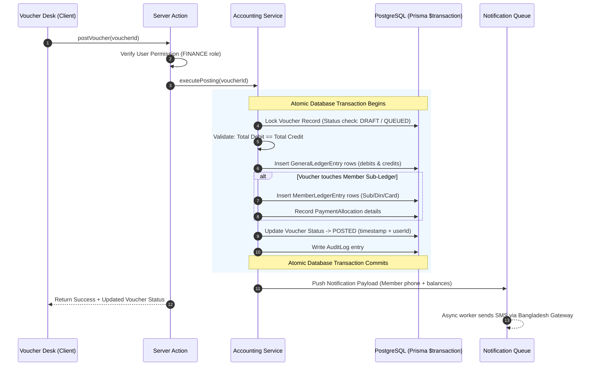

# System Architecture & Technical Design

## 1. Architectural Philosophy

The **Elite Club ERP** is engineered as a modern, full-stack TypeScript application adhering to the following core tenets:

1. **Domain-Driven Modular Design:** Clean separation between the UI presentation layer, the application service layer, and the persistence database layer.
2. **Accounting Invariant Integrity:** Invariants (such as $\sum \text{Debit} == \sum \text{Credit}$) are enforced at multiple levels: client-side validation, server-side transaction guards, and database constraints.
3. **Double-Entry Synchronization:** Member-level sub-ledgers (Subscription, Dining, Card Room) and the General Ledger (GL) are written inside the same atomic database transaction (`$transaction`), guaranteeing zero data drift.
4. **Non-Blocking External Services:** Slow or unreliable external services (such as Bangladesh SMS gateways) are processed via background job workers, completely decoupled from user-facing accounting operations.

---

## 2. Client vs. Server Layer Boundary

```
┌────────────────────────────────────────────────────────────────────────┐
│                        CLIENT LAYER (Next.js 15)                       │
│                                                                        │
│  • React 19 Client Components ('use client')                           │
│  • High-Density Tailwind CSS v4 Layouts                                │
│  • Keyboard Navigation & Shortcut Engine (Tab, Enter, Alt+P)           │
│  • Instant Balance Verification Badge (Debit - Credit == 0)            │
│  • Form Validation & Optimistic State Management                       │
└───────────────────────────────────┬────────────────────────────────────┘
                                    │
                       Server Actions / Typed RPC
                                    │
┌───────────────────────────────────▼────────────────────────────────────┐
│                        SERVER LAYER (Node.js)                          │
│                                                                        │
│  ┌──────────────────────────────────────────────────────────────────┐  │
│  │ Server Actions & API Controllers (src/server/actions/)           │  │
│  │ • User Authentication & RBAC Session Guards                      │  │
│  │ • Request Validation (Zod schemas)                               │  │
│  └──────────────────────────────────┬───────────────────────────────┘  │
│                                     │                                  │
│  ┌──────────────────────────────────▼───────────────────────────────┐  │
│  │ Domain Services (src/server/services/)                           │  │
│  │ • VoucherService: Numbers, line items, staging lifecycle         │  │
│  │ • AccountingService: Double-entry GL postings, balance calculations│  │
│  │ • MemberService: 3-Sub-Ledger updates, payment allocation        │  │
│  │ • NotificationService: SMS template creation, queue push         │  │
│  │ • ReportService: Trial balance, P&L, balance sheet aggregations  │  │
│  └──────────────────────────────────┬───────────────────────────────┘  │
│                                     │                                  │
│  ┌──────────────────────────────────▼───────────────────────────────┐  │
│  │ Persistence & Database Layer (Prisma 6 + PostgreSQL 18)          │  │
│  │ • Prisma Client Singleton (src/server/db.ts)                     │  │
│  │ • ACID $transaction blocks for postings                          │  │
│  │ • Native Decimal(14, 2) arithmetic (Zero floating-point errors)  │  │
│  └──────────────────────────────────────────────────────────────────┘  │
└───────────────────────────────────┬────────────────────────────────────┘
                                    │ Asynchronous Job Push
┌───────────────────────────────────▼────────────────────────────────────┐
│                    BACKGROUND WORKER (Redis / BullMQ)                  │
│                                                                        │
│  • SMS Gateway Dispatcher with exponential backoff retries             │
│  • Audit Trail Logger & Periodic Ledger Snapshotter                    │
└────────────────────────────────────────────────────────────────────────┘
```

---

## 3. Transaction Safety & Double-Entry Flow

When an accountant posts a voucher (e.g. Cash Receive `R1` for member dues), the server executes an atomic database transaction:



---

## 4. Role-Based Access Control (RBAC) Matrix

| Feature / Resource | President | Secretary | Finance | Administrator |
| :--- | :---: | :---: | :---: | :---: |
| **Executive Dashboard & KPIs** | Full Read | Full Read | Restricted Read | Full Read |
| **Member Directory View** | Read | Full Read | Full Read | Full Read |
| **Member Add / Edit / Family** | Read | **Create & Edit** | Read | Full Control |
| **Voucher Draft / Queue** | Read | No Access | **Create & Edit** | Full Control |
| **Voucher Posting (Locking)** | Approval View | No Access | **Execute** | Full Control |
| **Voucher Cancellation (Reversal)** | Approval View | No Access | **Execute** (with reason) | Full Control |
| **Chart of Accounts Modification** | No Access | No Access | **Manage** | Full Control |
| **Financial Reports (TB, P&L, BS)** | Full View | Permitted View | **Full View & Export** | Full View |
| **Sub-Code / Category Ledger** | Full View | Permitted View | **Full View & Export** | Full View |
| **Audit Log Visibility** | **Full Audit View** | Activity View | Transaction View | Full Audit View |
| **System Settings & User Mgt** | Read | Read | No Access | **Full Control** |
