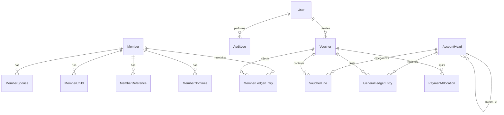

# Database Schema & Data Dictionary

## 1. Overview
The database engine is **PostgreSQL 18** managed via **Prisma ORM 6**. It uses native `Decimal(14, 2)` types to ensure zero floating-point arithmetic errors on currency balances.

---

## 2. Entity-Relationship Model

---

## 3. Data Dictionary

### Table: `users`
| Column | Type | Constraints | Description |
| :--- | :--- | :--- | :--- |
| `id` | UUID | PK, default `gen_random_uuid()` | Unique user identifier |
| `username` | VARCHAR(50) | UNIQUE, NOT NULL | Login username |
| `fullName` | VARCHAR(100) | NOT NULL | User's full display name |
| `email` | VARCHAR(100) | UNIQUE | Contact email |
| `phone` | VARCHAR(20) | NULLABLE | Contact mobile |
| `passwordHash` | TEXT | NOT NULL | Argon2 / bcrypt password hash |
| `role` | ENUM | NOT NULL | `PRESIDENT`, `SECRETARY`, `FINANCE`, `ADMIN` |
| `isActive` | BOOLEAN | DEFAULT TRUE | Active status |

### Table: `members`
| Column | Type | Constraints | Description |
| :--- | :--- | :--- | :--- |
| `id` | UUID | PK | Unique internal ID |
| `accountNo` | VARCHAR(30) | UNIQUE, NOT NULL | Account number (e.g. `PM-029`) |
| `prefix` | VARCHAR(10) | NULLABLE | Prefix code (e.g. `PM`) |
| `title` | VARCHAR(20) | NULLABLE | Honorific (Mr., Dr., Maj. Gen.) |
| `fullName` | VARCHAR(150) | NOT NULL | Member's full name |
| `creditLimit` | DECIMAL(12,2)| DEFAULT 0.00 | Max allowed credit before blocking chits |
| `status` | ENUM | DEFAULT 'ACTIVE' | `ACTIVE`, `INACTIVE`, `SUSPENDED` |
| `phone` | VARCHAR(30) | NOT NULL | Primary mobile (used for SMS alerts) |

### Table: `account_heads`
| Column | Type | Constraints | Description |
| :--- | :--- | :--- | :--- |
| `id` | UUID | PK | Unique account ID |
| `code` | VARCHAR(20) | UNIQUE, NOT NULL | Numeric code (e.g. `1101`, `5201`) |
| `name` | VARCHAR(100) | NOT NULL | Account title |
| `category` | ENUM | NOT NULL | `ASSET`, `LIABILITY`, `EQUITY`, `INCOME`, `EXPENSE` |
| `isControlHead` | BOOLEAN | DEFAULT FALSE | True if it's a parent control account |
| `parentId` | UUID | FK -> `account_heads.id` | Hierarchical parent group |

### Table: `vouchers`
| Column | Type | Constraints | Description |
| :--- | :--- | :--- | :--- |
| `id` | UUID | PK | Unique voucher ID |
| `voucherNo` | VARCHAR(30) | UNIQUE, NOT NULL | Formatted voucher number (e.g. `J3-7`, `P1-3`) |
| `voucherType` | ENUM | NOT NULL | `JOURNAL`, `CASH_PAYMENT`, `CASH_RECEIVE`, `BANK_PAYMENT`, `BANK_RECEIVE`, `CONTRA` |
| `voucherDate` | DATE | NOT NULL | Transaction date |
| `bankCode` | VARCHAR(30) | NULLABLE | Bank code for bank vouchers |
| `narration` | TEXT | NOT NULL | Description/memo |
| `status` | ENUM | DEFAULT 'DRAFT' | `DRAFT`, `QUEUED`, `POSTED`, `CANCELLED` |
| `totalAmount` | DECIMAL(14,2)| NOT NULL | Absolute total debit sum |
| `createdById` | UUID | FK -> `users.id` | User who authored the voucher |
| `postedAt` | TIMESTAMP | NULLABLE | Timestamp when posting finalized |

### Table: `member_ledger_entries`
| Column | Type | Constraints | Description |
| :--- | :--- | :--- | :--- |
| `id` | UUID | PK | Unique entry ID |
| `memberId` | UUID | FK -> `members.id` | Associated member |
| `voucherId` | UUID | FK -> `vouchers.id` | Sourced voucher |
| `ledgerType` | ENUM | NOT NULL | `SUBSCRIPTION`, `DINING`, `CARD_ROOM` |
| `entryDate` | DATE | NOT NULL | Date of charge or receipt |
| `debit` | DECIMAL(12,2)| DEFAULT 0.00 | Charge amount (increases member due) |
| `credit` | DECIMAL(12,2)| DEFAULT 0.00 | Payment amount (decreases member due) |
| `runningBalance`| DECIMAL(12,2)| NOT NULL | Balance after this transaction |
